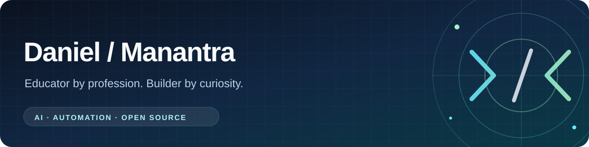

  

**Educator by profession. Builder by curiosity.**

I build practical software, make complex technology easier to understand, and contribute improvements upstream.

## 👋 About me

I work in **education and school social work** in Germany. Outside of that, I build practical tools at the intersection of **AI, Home Assistant, automation, and self-hosted software**.

I care about useful interfaces, reliable workflows, clear documentation, and technology that **keeps people in control**. I maintain my own projects and send fixes upstream to the open-source tools I use.

> Build useful things. Make them understandable. Keep people in control.

## 🚀 Featured projects

Independent projects and research I maintain under **Manantra** (not merely forks).

  
  &nbsp;&nbsp;
  

| Project | What it helps with |
| :-- | :-- |
| 🏠 **[HA Lens](https://github.com/Manantra/ha-lens)** TypeScript · React · Home Assistant | **Understand Home Assistant automations** through read-only flow graphs, execution paths, entity references, and the latest execution trace — without changing or running automations. |
| 🧠 **[CortexGate](https://github.com/Manantra/cortexgate)** JavaScript · PWA · Obsidian | **Review AI-generated summaries** in a mobile-friendly dashboard before deciding what belongs in an Obsidian knowledge base. |
| 🔬 **[Echo Dot / Crumpet Research](https://github.com/Manantra/echo-dot-crumpet-research)** Firmware analysis · Python · Research notes | **Investigate the Echo Dot 3rd Gen Refresh** using documented, read-only firmware and boot-chain analysis, with verified findings separated from hypotheses. No confirmed unlock is claimed. |

**Smaller everyday tools:** [Morning Dashboard](https://github.com/Manantra/morning-dashboard) (daily briefings from weather, calendar, tasks, and birthdays) · [People CRM](https://github.com/Manantra/people-crm) (personal contact and relationship management in OpenClaw).

[Browse all repositories](https://github.com/Manantra?tab=repositories)

## 🤝 Open-source contributions

I contribute fixes to the projects I use. **Merged pull requests are explicitly distinguished from open or closed-but-unmerged proposals.** A fork alone is not counted as an upstream contribution.

### 🌙 [Moonfin for Roku](https://github.com/Moonfin-Client/Roku) · Jellyfin & Emby client

Selected **merged upstream pull requests**:

| Focus | Contributions |
| :-- | :-- |
| **Emby compatibility** | [Server support, Connect login & playback · #277](https://github.com/Moonfin-Client/Roku/pull/277) |
| **Jellyfin & playback** | [Music routes & remote trailers · #281](https://github.com/Moonfin-Client/Roku/pull/281) · [Resume playback · #282](https://github.com/Moonfin-Client/Roku/pull/282) · [Live TV retries · #283](https://github.com/Moonfin-Client/Roku/pull/283) |
| **Multi-server correctness** | [Video · #284](https://github.com/Moonfin-Client/Roku/pull/284) · [Audio · #285](https://github.com/Moonfin-Client/Roku/pull/285) · [Detail actions · #286](https://github.com/Moonfin-Client/Roku/pull/286) |
| **Seerr interoperability** | [Fix Windows root-path JSON escaping · #301](https://github.com/Moonfin-Client/Roku/pull/301) |

Other proposals: [Emby settings labels · #287](https://github.com/Moonfin-Client/Roku/pull/287) (**open**) · [Season-display toggle · #302](https://github.com/Moonfin-Client/Roku/pull/302) (**closed without merge**).

### 🧠 [claude-mem](https://github.com/thedotmack/claude-mem) · OpenClaw integration

**Merged:** [Preserve extension metadata · #1113](https://github.com/thedotmack/claude-mem/pull/1113) · [Fix command-handler responses · #1115](https://github.com/thedotmack/claude-mem/pull/1115) · [Respect installer/plugin paths · #1116](https://github.com/thedotmack/claude-mem/pull/1116).

### 🏡 [Parqet Companion](https://github.com/cubinet-code/ha-parqet-companion) · Home Assistant

**Merged:** [Multiple Parqet accounts · #7](https://github.com/cubinet-code/ha-parqet-companion/pull/7).

**Open proposals:** [Reduce duplicate API requests and cache calendar activity · #10](https://github.com/cubinet-code/ha-parqet-companion/pull/10) · [German card localization · #11](https://github.com/cubinet-code/ha-parqet-companion/pull/11).

<strong>More open-source collaboration and proposals</strong>

- **[Hermes Agent](https://github.com/NousResearch/hermes-agent):** [Serialize concurrent dependency installs · #84766](https://github.com/NousResearch/hermes-agent/pull/84766) and [scope Kanban tool availability to agent context · #84816](https://github.com/NousResearch/hermes-agent/pull/84816) — submitted, not merged.
- **[Hermex](https://github.com/uzairansaruzi/hermex):** [Transcript voice bubbles · #44](https://github.com/uzairansaruzi/hermex/pull/44) — closed without merge.
- **[NZB Monkey Go](https://github.com/Tensai75/nzb-monkey-go):** Tested macOS `nzblnk://` link handling on Apple Silicon (M4) and shared [suggestions for permissions, safer logging, tests, and configuration updates](https://github.com/Tensai75/nzb-monkey-go/pull/47#issuecomment-6233690040). Local testing and discussion, **not** a separately authored or merged PR.
- **Moonfin:** [Windows path variant · #303](https://github.com/Moonfin-Client/Roku/pull/303) — closed without merge.

Hand-picked statuses checked on 26 October 2026; links lead to the individual pull requests. The section below is refreshed separately from GitHub API data.

## 📡 Latest GitHub activity

<!-- PROFILE_ACTIVITY:START -->
### Recently merged upstream contributions

Automatically gathered from my merged pull requests in other people's repositories.

- **[Moonfin-Client/Roku](https://github.com/Moonfin-Client/Roku)** — [Fix Seerr JSON escaping for Windows root folders · #301](https://github.com/Moonfin-Client/Roku/pull/301) · merged 2026-10-11
- **[Moonfin-Client/Roku](https://github.com/Moonfin-Client/Roku)** — [Keep remote detail actions on the item server · #286](https://github.com/Moonfin-Client/Roku/pull/286) · merged 2026-09-26
- **[Moonfin-Client/Roku](https://github.com/Moonfin-Client/Roku)** — [Fix remote audio playback context · #285](https://github.com/Moonfin-Client/Roku/pull/285) · merged 2026-09-26
- **[cubinet-code/ha-parqet-companion](https://github.com/cubinet-code/ha-parqet-companion)** — [feat: support multiple Parqet accounts · #7](https://github.com/cubinet-code/ha-parqet-companion/pull/7) · merged 2026-07-29
- **[thedotmack/claude-mem](https://github.com/thedotmack/claude-mem)** — [Respect existing installPath and plugins.load.paths in installer · #1116](https://github.com/thedotmack/claude-mem/pull/1116) · merged 2026-02-16
- **[thedotmack/claude-mem](https://github.com/thedotmack/claude-mem)** — [Fix installer overwriting package.json and losing openclaw.extensions · #1113](https://github.com/thedotmack/claude-mem/pull/1113) · merged 2026-02-16
- **[thedotmack/claude-mem](https://github.com/thedotmack/claude-mem)** — [Fix command handlers to return { text } per OpenClaw plugin API · #1115](https://github.com/thedotmack/claude-mem/pull/1115) · merged 2026-02-16

### Recently active original repositories

- **[ha-lens](https://github.com/Manantra/ha-lens)** — Open-source project
- **[echo-dot-crumpet-research](https://github.com/Manantra/echo-dot-crumpet-research)** — Read-only reverse engineering research on Amazon Echo Dot 3rd Gen Refresh \(Crumpet/C78MP8\)
- **[cortexgate](https://github.com/Manantra/cortexgate)** — A lightweight dashboard to review and curate AI-generated content summaries before saving them to your Second Brain \(Obs…
- **[morning-dashboard](https://github.com/Manantra/morning-dashboard)** — OpenClaw Skill: Daily briefing dashboard with weather, calendar, todos, birthdays
- **[people-crm](https://github.com/Manantra/people-crm)** — OpenClaw Skill: Personal CRM for contacts, family, friends, colleagues

Automated snapshot from the GitHub API. Updates arrive as draft pull requests and are published only after review.
<!-- PROFILE_ACTIVITY:END -->

[How this section is updated](docs/AUTOMATION.md) — the workflow proposes draft PRs for review; it does not auto-merge them.

## 🧰 Tools & interests

  
  
  
  
  
  
  
  

**Interested in:** smart-home troubleshooting, AI-assisted workflows, visual explanations, local-first software, knowledge management, and self-hosting.

## ❤️ Support my open-source work

I build and maintain these projects in my spare time. If my work is helpful, you can support it through [GitHub Sponsors](https://github.com/sponsors/Manantra). Sponsorship is optional; my open-source projects remain free to use.

---

  <strong>Thanks for stopping by!</strong> 
  <a href="https://github.com/Manantra?tab=repositories">Explore projects</a> ·
  <a href="https://github.com/pulls?q=is%3Apr+author%3AManantra">View upstream PRs</a>

