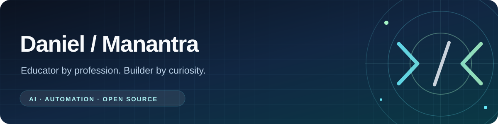

  

**Educator by profession. Builder by curiosity.**

I build practical software, make complex technology easier to understand, and contribute improvements upstream.

## 👋 About me

I work in **education and school social work** in Germany. I also build practical software—especially **Home Assistant integrations, self-hosted tools, AI-assisted workflows, and projects that make technology more approachable**.

My recent work ranges from local media playback insights and 3D-printer monitoring to automation debugging and educational experiences. I care about **clear interfaces, privacy, good documentation, and keeping people in control**. Alongside original projects, I maintain adaptations and contribute fixes to other open-source repositories.

> Build useful things. Make them understandable. Keep people in control.

## 🚀 Featured projects

These are **original projects and independent research** maintained under Manantra—not just copies of other repositories.

  
  &nbsp;&nbsp;
  

| Project | Why it exists |
| :-- | :-- |
| 📺 **[Infuse Now Playing](https://github.com/Manantra/ha-infuse)** Python · Home Assistant · Infuse | **Bring local Infuse playback into Home Assistant**: automatic device discovery, media-player and sensor states, playback events for automations, and built-in single-device / household dashboard cards. Reads playback status; does **not** remotely control playback. [HACS catalog inclusion](https://github.com/hacs/default/pull/13720) merged in November 2026. |
| 🏠 **[HA Lens](https://github.com/Manantra/ha-lens)** TypeScript · React · Home Assistant | **Understand Home Assistant automations** via read-only YAML flow graphs, entity references, bounded execution paths, and the latest execution trace—without changing or running automations. |
| 🖨️ **[BRESSER REX for Home Assistant](https://github.com/Manantra/home-assistant-bresser-rex)** Python · 3D printing · Home Assistant | **Monitor a compatible 3D printer locally** with temperature, status and progress sensors, optional camera, and LED controls. An **experimental** integration: core BRESSER REX features were tested on hardware; newer smart-plug features still need hardware validation. |
| 🧠 **[CortexGate](https://github.com/Manantra/cortexgate)** JavaScript · PWA · Obsidian | **Review AI-generated summaries before filing them** in an Obsidian-compatible knowledge base. The person reviewing—not the automation—decides what gets saved. |
| 🔬 **[Echo Dot / Crumpet Research](https://github.com/Manantra/echo-dot-crumpet-research)** Python · Firmware analysis · Documentation | **Investigate the Echo Dot 3rd Gen Refresh (C78MP8)** through source-linked, read-only firmware and boot-chain analysis. Verified evidence is distinguished from hypotheses; **no working root or unlock is claimed**. |

**Small tools:** [Morning Dashboard](https://github.com/Manantra/morning-dashboard) (OpenClaw daily briefings) · [People CRM](https://github.com/Manantra/people-crm) (contact and relationship management).

### 🌱 Adaptations & active forks

Forks are a different kind of work from original projects. I credit their maintainers and distinguish my changes from upstream releases.

- **[FlüsterWelt](https://github.com/Manantra/fluesterwelt)** — a **German-language adaptation** of [Shy Safari](https://github.com/teacherdotdev/shy-safari), a calm, interactive classroom sound-level experience. Developed around accessible language, localized UI and privacy-conscious browser microphone use.
- **[EverShelf (my fork)](https://github.com/Manantra/EverShelf)** — ongoing work based on [dadaloop82/EverShelf](https://github.com/dadaloop82/EverShelf), a self-hosted pantry manager. I'm exploring installation security, backup/restore hardening and safer release controls. **Several changes remain draft PRs in my fork—not upstream releases.**
- **[Infuse Dashboard Cards](https://github.com/Manantra/ha-infuse-cards)** — a **legacy migration bridge**, not a second standalone product to install: the two cards are now included with [Infuse Now Playing](https://github.com/Manantra/ha-infuse).

[Browse my public repositories](https://github.com/Manantra?tab=repositories)

## 🤝 Open-source contributions

I contribute fixes to the projects I use. **Merged pull requests are explicitly distinguished from open or closed-but-unmerged proposals.** A fork alone is not counted as an upstream contribution.

### 🌙 [Moonfin for Roku](https://github.com/Moonfin-Client/Roku) · Jellyfin & Emby client

Selected **merged upstream pull requests**:

| Focus | Contributions |
| :-- | :-- |
| **Emby compatibility** | [Server support, Connect login & playback · #277](https://github.com/Moonfin-Client/Roku/pull/277) · [Settings label cleanup · #287](https://github.com/Moonfin-Client/Roku/pull/287) |
| **Jellyfin & playback** | [Music routes & remote trailers · #281](https://github.com/Moonfin-Client/Roku/pull/281) · [Resume playback · #282](https://github.com/Moonfin-Client/Roku/pull/282) · [Live TV retries · #283](https://github.com/Moonfin-Client/Roku/pull/283) |
| **Multi-server correctness** | [Video · #284](https://github.com/Moonfin-Client/Roku/pull/284) · [Audio · #285](https://github.com/Moonfin-Client/Roku/pull/285) · [Detail actions · #286](https://github.com/Moonfin-Client/Roku/pull/286) |
| **Seerr interoperability** | [Fix Windows root-path JSON escaping · #301](https://github.com/Moonfin-Client/Roku/pull/301) |

Other proposal: [Season-display toggle · #302](https://github.com/Moonfin-Client/Roku/pull/302) (**closed without merge**).

### 🧠 [claude-mem](https://github.com/thedotmack/claude-mem) · OpenClaw integration

**Merged:** [Preserve extension metadata · #1113](https://github.com/thedotmack/claude-mem/pull/1113) · [Fix command-handler responses · #1115](https://github.com/thedotmack/claude-mem/pull/1115) · [Respect installer/plugin paths · #1116](https://github.com/thedotmack/claude-mem/pull/1116).

### 🏡 [Parqet Companion](https://github.com/cubinet-code/ha-parqet-companion) · Home Assistant

**Merged:** [Multiple Parqet accounts · #7](https://github.com/cubinet-code/ha-parqet-companion/pull/7).

**Open proposals:** [Reduce duplicate API requests and cache calendar activity · #10](https://github.com/cubinet-code/ha-parqet-companion/pull/10) · [German card localization · #11](https://github.com/cubinet-code/ha-parqet-companion/pull/11).

### 🧩 [HACS catalog](https://github.com/hacs/default) · Home Assistant ecosystem

**Merged upstream:** [Include Infuse Now Playing as an integration · #13720](https://github.com/hacs/default/pull/13720) (November 2026).

The separate [cards-catalog proposal · #13721](https://github.com/hacs/default/pull/13721) closed **without merge**; the cards are now bundled with the main integration.

<strong>More open-source collaboration and proposals</strong>

- **[Hermes Agent](https://github.com/NousResearch/hermes-agent):** [Serialize concurrent dependency installs · #84766](https://github.com/NousResearch/hermes-agent/pull/84766) and [scope Kanban tool availability to agent context · #84816](https://github.com/NousResearch/hermes-agent/pull/84816) — submitted, not merged.
- **[Hermex](https://github.com/uzairansaruzi/hermex):** [Transcript voice bubbles · #44](https://github.com/uzairansaruzi/hermex/pull/44) — closed without merge.
- **[NZB Monkey Go](https://github.com/Tensai75/nzb-monkey-go):** Tested macOS `nzblnk://` link handling on Apple Silicon (M4) and shared [suggestions for permissions, safer logging, tests, and configuration updates](https://github.com/Tensai75/nzb-monkey-go/pull/47#issuecomment-6233690040). Local testing and discussion, **not** a separately authored or merged PR.
- **Moonfin:** [Windows path variant · #303](https://github.com/Moonfin-Client/Roku/pull/303) — closed without merge.

Selected pull-request statuses checked on 17 November 2026. The GitHub API-backed activity below is maintained separately through review-first draft PRs.

## 📡 Latest GitHub activity

<!-- PROFILE_ACTIVITY:START -->
### Recently merged upstream contributions

Automatically gathered from my merged pull requests in other people's repositories.

- **[Moonfin-Client/Roku](https://github.com/Moonfin-Client/Roku)** — [Cleanup emby settings labels · #287](https://github.com/Moonfin-Client/Roku/pull/287) · merged 2026-11-14
- **[hacs/default](https://github.com/hacs/default)** — [Adds new integration \[Manantra/ha-infuse\] · #13720](https://github.com/hacs/default/pull/13720) · merged 2026-11-09
- **[Moonfin-Client/Roku](https://github.com/Moonfin-Client/Roku)** — [Fix Seerr JSON escaping for Windows root folders · #301](https://github.com/Moonfin-Client/Roku/pull/301) · merged 2026-10-11
- **[Moonfin-Client/Roku](https://github.com/Moonfin-Client/Roku)** — [Keep remote detail actions on the item server · #286](https://github.com/Moonfin-Client/Roku/pull/286) · merged 2026-09-26
- **[cubinet-code/ha-parqet-companion](https://github.com/cubinet-code/ha-parqet-companion)** — [feat: support multiple Parqet accounts · #7](https://github.com/cubinet-code/ha-parqet-companion/pull/7) · merged 2026-07-29
- **[thedotmack/claude-mem](https://github.com/thedotmack/claude-mem)** — [Respect existing installPath and plugins.load.paths in installer · #1116](https://github.com/thedotmack/claude-mem/pull/1116) · merged 2026-02-16
- **[thedotmack/claude-mem](https://github.com/thedotmack/claude-mem)** — [Fix installer overwriting package.json and losing openclaw.extensions · #1113](https://github.com/thedotmack/claude-mem/pull/1113) · merged 2026-02-16
- **[thedotmack/claude-mem](https://github.com/thedotmack/claude-mem)** — [Fix command handlers to return { text } per OpenClaw plugin API · #1115](https://github.com/thedotmack/claude-mem/pull/1115) · merged 2026-02-16

### Recently active original repositories

- **[ha-infuse](https://github.com/Manantra/ha-infuse)** — Infuse Now Playing for Home Assistant — local playback monitoring and multi-device dashboards
- **[ha-lens](https://github.com/Manantra/ha-lens)** — Open-source project
- **[ha-infuse-cards](https://github.com/Manantra/ha-infuse-cards)** — Home Assistant Marketplace dashboard cards for Infuse Now Playing
- **[home-assistant-bresser-rex](https://github.com/Manantra/home-assistant-bresser-rex)** — Unofficial Home Assistant integration for BRESSER REX and FlashForge Adventurer III 3D printers.
- **[echo-dot-crumpet-research](https://github.com/Manantra/echo-dot-crumpet-research)** — Read-only reverse engineering research on Amazon Echo Dot 3rd Gen Refresh \(Crumpet/C78MP8\)

Automated snapshot from the GitHub API. Updates arrive as draft pull requests and are published only after review.
<!-- PROFILE_ACTIVITY:END -->

[How this section is updated](docs/AUTOMATION.md) — the workflow proposes draft PRs for review; it does not auto-merge them.

## 🧰 Tools & interests

  
  
  
  
  
  
  
  

**Interested in:** Home Assistant and smart-home troubleshooting, educational technology, local media APIs, 3D printing, AI-assisted workflows, knowledge management, privacy-conscious design, and self-hosting.

## ❤️ Support my open-source work

I build and maintain these projects in my spare time. If my work is helpful, you can support it through [GitHub Sponsors](https://github.com/sponsors/Manantra). Sponsorship is optional; my open-source projects remain free to use.

---

  <strong>Thanks for stopping by!</strong> 
  <a href="https://github.com/Manantra?tab=repositories">Explore projects</a> ·
  <a href="https://github.com/pulls?q=is%3Apr+author%3AManantra">View upstream PRs</a>

